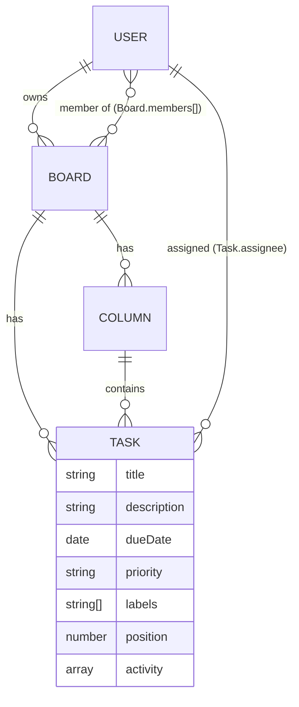

# Schema

**Embedded:** `labels`, `activity` (small, owned by the task, never queried alone). **Referenced:** members, columns, tasks (shared, unbounded, moved/filtered independently).
**Indexes:** `Board{members}`, `Column{board,order}`, `Task{board,column,position}`, `Task{board,assignee}`, `Task{board,dueDate}`, `User{email}` unique.
